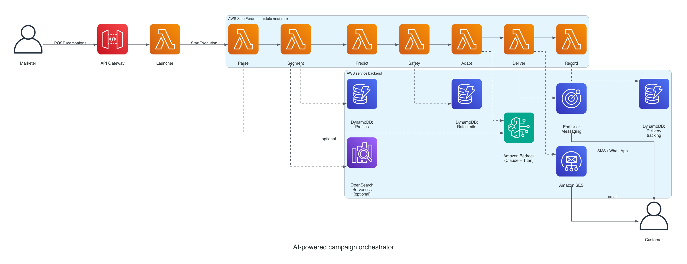

# Build an AI campaign orchestrator with Amazon Bedrock and AWS End User Messaging

> ⚠️ **SAMPLE / DEMO APPLICATION**
>
> This is a **sample application for educational purposes only**. It is **NOT suitable for production use** without additional security hardening, compliance review, and proper AWS End User Messaging + Amazon Bedrock configuration. The stack ships with mock customer data seeded by `scripts/seed_demo_data.py`, permissive default rate limits, and no AWS WAF in front of the API. Do not deploy as-is into a regulated environment.

Companion code for the AWS blog post *[Build an AI campaign orchestrator with Amazon Bedrock and AWS End User Messaging](#)*.

Marketing teams running large-scale campaigns often send the same message across SMS, WhatsApp, and email regardless of how each customer engages or how many messages they've already received that week. This sample shows how to build a campaign orchestrator on AWS End User Messaging and Amazon Bedrock that predicts the best channel for each customer, adapts content per channel, and holds back messages to fatigued or unhappy customers.

## Table of contents

- [Architecture](#architecture)
- [Prerequisites](#prerequisites)
- [Deployment](#deployment)
- [Test the solution](#test-the-solution)
- [Local Flask UI (optional)](#local-flask-ui-optional)
- [Semantic segmentation (optional)](#semantic-segmentation-optional)
- [Repository layout](#repository-layout)
- [Clean up](#clean-up)
- [Security](#security)
- [License](#license)

## Architecture



A marketer types a plain-language instruction into the campaign launcher. Amazon API Gateway forwards the instruction to an AWS Lambda function, which starts an AWS Step Functions state machine. The state machine walks the campaign through seven stages, from understanding the instruction to dispatching messages on the right channels.

| Stage              | AWS service                                                 | Purpose                                                   |
| ------------------ | ----------------------------------------------------------- | --------------------------------------------------------- |
| ParseInstruction   | Amazon Bedrock (Claude)                                     | Convert natural language into structured filters          |
| SegmentCustomers   | Amazon DynamoDB + (optional) Amazon OpenSearch Serverless   | Hard filters in DynamoDB, optional k-NN semantic search   |
| PredictChannels    | Amazon SageMaker AI (optional) + heuristic fallback         | Pick SMS, WhatsApp, or email per customer                 |
| CheckSafety        | Amazon DynamoDB                                             | Drop fatigued or negative-sentiment customers             |
| AdaptContent       | Amazon Bedrock (Claude)                                     | Generate one message variant per channel                  |
| DeliverMessages    | AWS End User Messaging, Amazon Simple Email Service (SES)   | Dispatch messages and record sends idempotently           |
| RecordResults      | Amazon DynamoDB                                             | Persist the campaign summary                              |

Amazon EventBridge routes delivery-status callbacks from AWS End User Messaging back to a separate Lambda that updates the delivery tracking table.

## Prerequisites

- An AWS account with permission to create AWS Step Functions, AWS Lambda, Amazon API Gateway, Amazon DynamoDB, Amazon S3, Amazon Cognito, Amazon SNS, AWS KMS, IAM, and Amazon EventBridge resources.
- [AWS CLI v2](https://aws.amazon.com/cli/) configured with credentials.
- [AWS SAM CLI](https://docs.aws.amazon.com/serverless-application-model/latest/developerguide/install-sam-cli.html) v1.100+.
- Python 3.13 on your PATH (the Lambda runtime). If your local Python is a different version, set `SAM_USE_CONTAINER=1` and start Docker so SAM builds the Lambdas in a container.
- Amazon Bedrock model access granted for `global.anthropic.claude-haiku-4-5-20251001-v1:0` in your AWS Region.
- A [WhatsApp Business account](https://business.whatsapp.com/) linked to AWS End User Messaging Social (required only for live WhatsApp sends).
- (Optional) An Amazon SageMaker AI endpoint for channel prediction. The orchestrator calls the endpoint when it is configured and falls back to the customer's stored `preferred_channel` otherwise.

## Deployment

Clone the repository and run the deploy script from the repository root:

```bash
git clone https://github.com/aws-samples/sample-ai-campaign-orchestrator.git
cd sample-ai-campaign-orchestrator
./scripts/deploy.sh --guided
```

The script prompts you for an AWS Region, a stack name, and the orchestrator parameters (WhatsApp phone number ID, optional SES sender, optional SageMaker endpoint name). It runs `sam build` followed by `sam deploy`, and prints the API endpoint plus other stack outputs when the deployment finishes.

Re-run `./scripts/deploy.sh` without the `--guided` flag for subsequent deployments; SAM reads your saved answers from `samconfig.toml`.

### Enabling live channel sends

The stack deploys without any channel credentials, and the DeliverMessages stage records a `failed` status for every send attempt until you provide them. Redeploy with these parameters to enable each channel:

| Parameter               | What it is                                                                                                                                                             |
| ----------------------- | ---------------------------------------------------------------------------------------------------------------------------------------------------------------------- |
| `SenderEmail`           | A [verified SES identity](https://docs.aws.amazon.com/ses/latest/dg/creating-identities.html). In the SES sandbox both the sender and every recipient must be verified. |
| `PhonePoolId`           | An [AWS End User Messaging SMS phone pool ID](https://docs.aws.amazon.com/sms-voice/latest/userguide/phone-pools.html). New accounts start in the SMS sandbox.         |
| `SmsMessageType`        | `PROMOTIONAL` (default) or `TRANSACTIONAL`. Must match the message type your phone number or pool is registered for, or `SendTextMessage` rejects the send with `INVALID_PARAMETER`. |
| `WhatsAppPhoneNumberId` | An [AWS End User Messaging Social phone number ID](https://docs.aws.amazon.com/social-messaging/latest/userguide/getting-started.html) from a linked WhatsApp Business Account. |

### WhatsApp templates are required

WhatsApp prohibits free-form business-initiated messages outside a 24-hour customer-service window, so the DeliverMessages stage sends **approved template messages** instead. Pass the template name with the campaign request (see [Test the solution](#test-the-solution)). The template must already be APPROVED on the WABA you linked.

List the approved templates on your WABA:

```bash
aws socialmessaging list-whatsapp-message-templates \
  --id <waba-id> \
  --query 'templates[?templateStatus==`APPROVED`].[templateName,templateLanguage,templateCategory]' \
  --output table
```

### Cognito authentication

The API is protected by an Amazon Cognito user pool. Grab the `UserPoolId`, `UserPoolClientId`, and `CampaignApiEndpoint` from the stack outputs:

```bash
STACK=<your-stack-name>
REGION=<your-region>

POOL_ID=$(aws cloudformation describe-stacks --stack-name $STACK --region $REGION \
  --query 'Stacks[0].Outputs[?OutputKey==`UserPoolId`].OutputValue' --output text)
CLIENT_ID=$(aws cloudformation describe-stacks --stack-name $STACK --region $REGION \
  --query 'Stacks[0].Outputs[?OutputKey==`UserPoolClientId`].OutputValue' --output text)
ENDPOINT=$(aws cloudformation describe-stacks --stack-name $STACK --region $REGION \
  --query 'Stacks[0].Outputs[?OutputKey==`CampaignApiEndpoint`].OutputValue' --output text)
```

Create one API user and set a permanent password:

```bash
aws cognito-idp admin-create-user \
  --user-pool-id $POOL_ID --username marketer@example.com \
  --message-action SUPPRESS --region $REGION

aws cognito-idp admin-set-user-password \
  --user-pool-id $POOL_ID --username marketer@example.com \
  --password '<StrongPassword123!>' --permanent --region $REGION
```

Exchange the password for an access token whenever you need one:

```bash
TOKEN=$(aws cognito-idp initiate-auth \
  --auth-flow USER_PASSWORD_AUTH \
  --client-id $CLIENT_ID \
  --auth-parameters USERNAME=marketer@example.com,PASSWORD='<StrongPassword123!>' \
  --region $REGION \
  --query 'AuthenticationResult.AccessToken' --output text)
```

## Test the solution

After the stack finishes deploying, seed the customer profiles table with sample customers and run a campaign against them.

Seed synthetic customers:

```bash
python scripts/seed_demo_data.py --count 100
```

For a live end-to-end WhatsApp send, also seed one customer whose phone is yours (E.164, no spaces) and whose `preferred_channel` is `whatsapp`:

```bash
python scripts/seed_demo_data.py --whatsapp-recipient +911234567890 --no-synthetic
```

Submit a campaign instruction:

```bash
curl -X POST "$ENDPOINT" \
  -H "Authorization: $TOKEN" \
  -H 'content-type: application/json' \
  -d '{
    "instruction": "Send the Andaman package to Mumbai customers",
    "whatsapp_template": {"name": "promotional_discount_bangalore_laptop", "language": "en_US"}
  }'
```

From here you can:

1. Watch the campaign execution in the [Step Functions console](https://console.aws.amazon.com/states/home).
2. Query the delivery tracking table in Amazon DynamoDB to see which customers the safety stage approved or suppressed, and which channel the orchestrator picked for each.
3. Check the recipient's phone for the WhatsApp template message that the deliver stage sent.

## Local Flask UI (optional)

`src/ai_cpaas_demo/web/` is a thin local web UI that calls Step Functions directly through boto3 using your own AWS credentials. Useful for demoing the orchestrator without writing a client. It bypasses Cognito because it doesn't go through the public API.

```bash
pip install -r requirements.txt

export AWS_REGION=$REGION
export CAMPAIGN_STATE_MACHINE_ARN=$(aws cloudformation describe-stacks \
  --stack-name $STACK --region $REGION \
  --query 'Stacks[0].Outputs[?OutputKey==`StateMachineArn`].OutputValue' --output text)
export DELIVERY_TRACKING_TABLE=$(aws cloudformation describe-stacks \
  --stack-name $STACK --region $REGION \
  --query 'Stacks[0].Outputs[?OutputKey==`DeliveryTrackingTableName`].OutputValue' --output text)
export WABA_ID=waba-xxxxxxxxxxxxxxxx    # from `aws socialmessaging list-linked-whatsapp-business-accounts`
export FLASK_ENV=production
./start.sh
```

Open `http://localhost:8080`, type a campaign instruction, pick a template, and choose Launch. The page renders eligible, approved, suppressed, and sent counts from the campaign summary.

## Semantic segmentation (optional)

To target customers by lifestyle or affinity ("budget-conscious families interested in beach vacations"), redeploy with:

```bash
sam deploy --parameter-overrides \
  EnableSemanticSearch=true \
  SeederPrincipalArn=$(aws sts get-caller-identity --query Arn --output text)
```

This provisions an Amazon OpenSearch Serverless NextGen Vector search collection. NextGen collections scale indexing and search OCUs to zero after 10 minutes of inactivity, so idle cost is close to zero; expect a 30 to 60 second cold start on the first query after idle.

With semantic segmentation on:

- `scripts/seed_demo_data.py` embeds each customer profile with Amazon Titan Text Embeddings v2 and writes the vector into the collection alongside the DynamoDB row.
- The ParseInstruction stage extracts a `semantic_query` field from instructions with lifestyle or affinity phrasing.
- The SegmentCustomers stage runs the DynamoDB filter AND a k-nearest-neighbor search, and returns the intersection.

## Repository layout

```
.
├── template.yaml                              # AWS SAM template (one-stack deploy)
├── statemachine/
│   └── campaign_orchestrator.asl.json         # Step Functions state machine
├── infrastructure/lambdas/                    # Seven stage handlers + launcher + status + callback
│   ├── parse_instruction.py
│   ├── segment_customers.py
│   ├── predict_channels.py
│   ├── check_safety.py
│   ├── adapt_content.py
│   ├── deliver_messages.py
│   ├── record_results.py
│   ├── campaign_launcher.py
│   ├── campaign_status.py
│   ├── delivery_status_processor.py
│   └── requirements.txt
├── scripts/
│   ├── deploy.sh
│   ├── cleanup.sh
│   └── seed_demo_data.py
├── docs/
│   ├── architecture.py                        # Regenerate the diagram
│   └── architecture.png
└── src/ai_cpaas_demo/web/                     # Optional local Flask UI
```

## Clean up

To avoid incurring future charges, delete the resources you created:

```bash
./scripts/cleanup.sh
```

The script empties the campaign assets S3 bucket (versions and delete markers) and runs `sam delete` on the stack. The stack deletion removes the AWS Step Functions state machine, AWS Lambda functions, Amazon DynamoDB tables, Cognito user pool, and (when configured) the Amazon OpenSearch Serverless collection.

## Security

Each stage Lambda runs under its own IAM role, scoped to the minimum services it calls. The parse and adapt Lambdas can invoke only the Bedrock model or inference profile declared in `template.yaml`. The segment Lambda reads only the customer-profiles table and, when semantic segmentation is on, invokes Titan and queries the OpenSearch collection. The deliver Lambda sends only through AWS End User Messaging and the SES sender you configure. All DynamoDB tables and the OpenSearch collection are encrypted with a stack-owned AWS KMS key.

The API Gateway endpoint is protected by an Amazon Cognito user pool. Callers exchange a username and password for a short-lived JWT access token and pass that token in the `Authorization` header of each request. The pool defaults to admin-created users only, so nobody can self-register against your deployment. For production workloads, also add rate limiting on the API stage and AWS WAF at the edge to protect against abuse.

The DeliverMessages stage is idempotent across AWS Step Functions retries. Each recipient is reserved atomically in the delivery tracking table before the provider API call, so a mid-loop timeout followed by a retry sends at most one message per (campaign, customer, channel).

## License

This library is licensed under the MIT-0 License. See the [LICENSE](./LICENSE) file.
